# Architecture

Six stages run in a fixed order under code control. **Code** owns record accounting, validation, budgets, arithmetic and
every number that reaches the memo. **Models** read messy language inside four bounded roles. Every handoff is a saved
file or table, so any stage can be inspected or rerun from its inputs.

```mermaid
flowchart TB
  subgraph SRC["Source"]
    CSV["spotify_reviews_18months.csv<br/>660,622 rows · sha256 1fc85de6…"]
  end

  subgraph S1["1 · Ingest — CODE"]
    ING["strict multiline CSV parser<br/>row_sha (course helper) · profile<br/>exact-duplicate texts · pending queue"]
  end

  subgraph S2["2 · Enrich — MODEL gpt-6-luna (effort none, flex) + CODE checks"]
    Q["pending distinct texts<br/>+ result cache lookup (exact text + label_config)"]
    EN["enrich role<br/>≤ 50 reviews / request<br/>strict JSON schema (enums)"]
    VAL{"code validation<br/>index set · enums · ranges<br/>quote ⊂ text · entities by lexicon"}
    Q -->|"batch ≤50"| EN --> VAL
    VAL -->|"invalid: retry once"| EN
    VAL -->|"2nd failure: quote → full text + needs_review,<br/>else quarantine(reason, attempts)"| SAVE
    VAL -->|valid| SAVE["atomic per-batch commit<br/>results + call log + cache"]
  end

  subgraph S3["3 · Verify — MODEL (blind) + CODE compare"]
    VS["declared sample<br/>sha256(seed:id) < 2%"] --> VR["verify role<br/>text + rubric only"] --> VC["code compares<br/>disagreement report"]
  end

  subgraph S4["4 · Group — CODE membership + MODEL naming"]
    GM["issue_id = topic.subtopic<br/>one issue per complaint"] --> GN["group role<br/>names & coherence from ≤8 examples/issue<br/>(cannot change membership)"]
  end

  subgraph S5["5 · Rank — CODE only"]
    RK["severity_sum = count × mean<br/>sort −score, +issue_id<br/>Decimal half-up means"]
  end

  subgraph S6["6 · Recommend — MODEL + CODE claim check"]
    MI["memo inputs: ranking, area aggregates,<br/>claims (code), bounded evidence pack"] --> MM["memo role"] --> MC{"code check: claim IDs, every<br/>number, every review ID"}
    MC -->|"reject: retry once with the problem"| MM
  end

  CSV --> ING -->|"reviews table · ingestion.json<br/>13 empty → quarantined"| Q
  SAVE -->|"enriched.jsonl · quarantine.jsonl"| VS
  SAVE --> GM
  GN -->|"membership.csv · issues.json"| RK
  RK -->|"ranking.csv · aggregates.csv"| MI
  MC -->|"memo.md · claims.csv"| OUT

  subgraph OUT["Saved evidence"]
    G["grading/ export<br/>records · membership · ranking · claims · calls · checkpoints"]
    C["cost/ calculator<br/>offline replay"]
  end

  subgraph SERVE["Serving (no model calls)"]
    LOAD["dashboard/db/load.py<br/>COPY saved outputs"] --> DB[("Neon Postgres<br/>reviews · issues · aggregates · claims · memo · metrics")]
    DB --> API["Vercel functions /api/*<br/>read-only, parameterized SQL"] --> UI["Dashboard<br/>metrics · ranking · AI memo · evidence drill-down"]
  end
  OUT --> LOAD

  CTRL["Orchestrator controls: shared spend ledger with pre-dispatch reservations (run cap + $9.50 project cap)<br/>· bounded transient retries with backoff + jitter · time cap · Ctrl-C drains in-flight batches · resume skips completed IDs<br/>· insufficient_quota is fatal · model allowlist"]
  CTRL -.-> S2
  CTRL -.-> S3
  CTRL -.-> S6
```

## Stage contracts

| Stage | Owner | Input | Output (saved) | Failure behaviour | Stop condition |
|---|---|---|---|---|---|
| 1 Ingest | code | any CSV path | `reviews` table, `ingestion_report.json`, `ingestion.json` (course profile), `quarantine_ingest.jsonl` | malformed CSV aborts (strict parser); empty text → `quarantined: empty_review_text` | file fully read |
| 2 Enrich | model `enrich` + code | ≤50 distinct pending texts per request (text only, no stars) | `results`, `enriched.jsonl`, `quarantine.jsonl`, `calls`, result cache | transient: ≤4 retries with backoff + jitter; invalid: retry once, then a full-text quote + `needs_review`, or quarantine with reason | queue empty · spend cap · time cap · Ctrl-C · 3 consecutive exhausted batches · `insufficient_quota` |
| 3 Verify | model `verify` + code | declared 2% hash sample, text + rubric only | `verify/verifier_predictions.jsonl`, `disagreements.jsonl`, `verify_summary.json` | invalid: retry once; failures logged, sample marked unverified | sample done · spend cap |
| 4 Group | code + model `group` | completed complaint/cancellation records; ≤8 examples per issue for naming | `membership.csv`, `issues.json` | naming failure falls back to issue_id; membership never depends on the model | all issues named or fallen back |
| 5 Rank | code | `enriched.jsonl` + `membership.csv` | `ranking.csv`, `aggregates.csv`, `topic_aggregates.csv` | deterministic; reproducible offline | — |
| 6 Recommend | model `memo` + code | aggregates, code-made claims, bounded evidence pack (never raw data) | `memo.md`, `memo.json`, `claims.csv`, `memo_inputs.json` | validator rejects unknown claim, number or review ID → one retry with feedback → saved with failures visible | validated or failed-visible |

## Why each model call exists (and what code does instead)

- **Enrich**: topic, intent, severity and sentiment need reading comprehension (slang, mixed languages, sarcasm, multi-issue reviews). Code does everything around it: dedupe, batching, ID mapping, quote membership, entity extraction (lexicon), sentiment scaling, retries and quarantine.
- **Verify**: an independent second reading is the only way to estimate label disagreement at scale without human labels. The comparison itself is code.
- **Group**: membership is a deterministic rule (code). The model only writes human-readable names and flags incoherent issues from a bounded sample.
- **Memo**: turning ranked numbers into a recommendation with alternatives is a language task. Every number it may use is computed and checked by code.

## Where code decides the next step

The orchestrator (`pipeline/orchestrator.py`) runs the stages in order and **skips all downstream stages while any review is still pending**. The enrichment loop decides dispatch: it admits a batch only if the spend ledger can reserve that batch's worst-case cost; a stop flag (spend, time, interrupt or fatal error) stops admission, and in-flight batches are still saved. Retries are capped: invalid output gets one retry, transient errors up to four.
